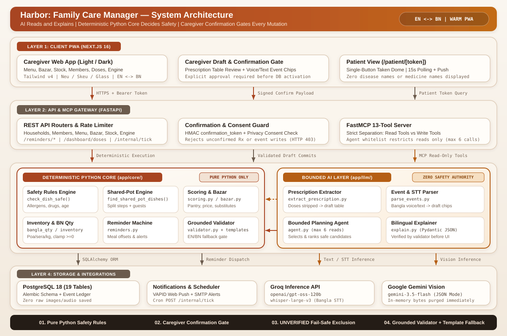

# Harbor: Family Care Manager

**Harbor** is a bilingual (Bangla-first, full Bangla / English conversion) Progressive Web App designed for multi-condition households managed by a single family caregiver. When family members manage overlapping dietary needs and medication schedules—such as chronic kidney disease, diabetes, hypertension, elevated uric acid, and food allergies—Harbor identifies shared-pot meals that everyone can safely eat or split at a specific cooking step, tracks pantry inventory using Bangla units, plans monthly grocery budgets, and delivers meal-timed medication reminders.

---

## System Architecture

Harbor enforces a strict separation between natural-language parsing/explanation and safety-critical decision making: **AI reads and explains; deterministic Python code decides.**



### Architectural Layers

| Layer | Module Path | Responsibility | External Network / LLM Calls |
| :--- | :--- | :--- | :--- |
| **Client PWA** | `frontend/` | Caregiver workspace, confirmation gates, patient reminder screen, EN/BN switcher, warm Light/Dark UI | REST calls to FastAPI |
| **API & Tool Gateway** | `backend/app/api/`, `backend/app/mcp/` | Authenticated REST endpoints, signed `confirmation_token` verification, FastMCP 13-tool server | Request handling only |
| **Deterministic Core** | `backend/app/core/` | Dish safety checks, shared-pot splitting, scoring, Bangla unit normalization, inventory math, reminder FSM, validator, bazar planner | Strictly zero |
| **Bounded AI Layer** | `backend/app/llm/` | Prescription extraction (doses stripped), Bangla voice/text event parsing, bounded planning agent (<= 6 read calls), grounded explanations | Groq & Gemini APIs |
| **Persistence & Alerts** | PostgreSQL 18, `services/` | 19-table relational schema via Alembic, audit logs (`llm_calls`), VAPID Web Push, SMTP escalation, `/internal/tick` | PostgreSQL, Web Push, SMTP |

---

## Core Engineering & Safety Guardrails

1. **Zero AI Food-Safety Authority:** `backend/app/llm/` never computes or overrides safety verdicts. All dish eligibility evaluates deterministically through `check_dish_safe` and `find_shared_pot_dishes` in pure Python.
2. **Non-Prescriptive Medication Boundaries:** Harbor never recommends starting, stopping, or changing medications and never parses, stores, displays, or outputs medication dosages.
3. **Mandatory Caregiver Confirmation Gate:** Prescription extractions and parsed voice/text household events remain inert drafts until explicitly verified and submitted by the caregiver with a server-signed HMAC `confirmation_token`.
4. **Fail-Safe `UNVERIFIED` Handling:** Unmapped ingredients, unmapped drug classes, or unverified member medicines cause affected dishes to evaluate to `UNVERIFIED` and remain excluded from recommendations.
5. **Grounded Explanation Validator:** Every LLM-generated dish explanation passes deterministic lexical verification (`core/validator.py`) against actual engine outputs before reaching the UI, automatically falling back to verified Bangla/English templates on mismatch or API outage.
6. **Prototype Clinical Scope Notice:** Reference seed data (`51` ingredients, `172` Bangla/English aliases, `40` Bangladeshi recipes, `5` drug classes, `4` drug-food rules, `4` diet presets) is compiled from general nutrition and pharmacology references and requires review by a qualified pharmacist or dietitian prior to clinical deployment.
7. **Privacy-Preserving Patient Mode & Notifications:** Lock-screen Web Push payloads and the `/patient/[token]` reminder screen display strictly generic prompts (for example, `"ওষুধের সময় হয়েছে"` / `"Time for medicine"`) with zero disease names, condition tags, or medicine names.
8. **Approximate Pricing Disclosure:** All estimated ingredient and monthly bazar prices carry explicit `"আনুমানিক"` / `"Estimated"` markers unless backed by recent household purchase observations.
9. **Transient Media Handling & Consent:** Caregiver consent is verified (`consent_given`) prior to calling third-party AI APIs on prescription photos or voice recordings. Raw prescription images and audio bytes are processed strictly in memory and never persisted to disk or database columns.

---

## REST API Surface

All caregiver routes require `Authorization: Bearer <token>` obtained via `/households`, `/households/login`, or `/households/demo`. Error responses return structured JSON (`{ "code", "message", "details" }`).

| Domain | Endpoints | Purpose |
| :--- | :--- | :--- |
| **System** | `GET /healthz`, `GET /drug-classes`, `GET /eval/results` | Database readiness, modelled drug-class catalog, measured evaluation artifact access |
| **Households** | `POST /households`, `POST /households/login`, `POST /households/demo`, `GET /households/{id}/state`, `PATCH /households/{id}/settings` | Registration/login, demo household (`DEMO26`), consolidated state, meal times & consent |
| **Members & Meds** | `GET/POST /members`, `GET/PATCH/DELETE /members/{id}`, `POST/PATCH/DELETE /members/{id}/medicines/{med_id}` | Member profiles (conditions, allergies, presets), verified medicines, daily dose scheduling |
| **Prescriptions** | `POST /members/{id}/prescription`, `POST /prescriptions/{id}/confirm` | Transient Gemini vision draft extraction (zero doses) and signed caregiver confirmation |
| **Events & Stock** | `POST /events/parse`, `POST /events/confirm`, `GET /stock`, `POST /stock/adjust` | Voice/text Bangla event draft chips, ledger commits, non-negative stock calculation, manual adjustments |
| **Daily Menu** | `POST /menu/suggest`, `POST /menu/review`, `POST /menu/cooked` | Shared-pot top-3 ranking, guest/absence re-evaluation, cooked ingredient deductions |
| **Bazar** | `POST /bazar/build`, `POST /bazar/confirm`, `POST /bazar/purchased`, `GET /bazar/latest` | Monthly ingredient aggregation, seasonality, safe substitutions, budget trimming, purchase logging |
| **Reminders & Alerts** | `GET /reminders/due`, `POST /reminders/{dose_id}/taken`, `GET /dashboard/doses`, `POST /push/subscribe`, `POST /internal/tick` | Token-scoped patient polling & confirmation, caregiver dose dashboard, push subscriptions, cron tick |
| **Engine Explorer** | `GET /engine/catalog`, `POST /engine/check` | Read-only deterministic rule trace inspection for any household or custom profile |

---

## Verified Technology Stack

| Component | Technology & Exact Versions |
| :--- | :--- |
| **Backend Runtime** | Python `3.11.9`, FastAPI `0.165.0`, Uvicorn `0.54.0`, Pydantic `2.14.4`, Pydantic Settings `2.16.3` |
| **Database & Migrations** | PostgreSQL `18` (`harbor_dev`, `harbor_test`), SQLAlchemy `2.1.9`, Alembic `1.20.1`, Psycopg `3.3.9` |
| **MCP & Security** | FastMCP `4.2.4`, `bcrypt==5.0.0`, `itsdangerous==2.2.0`, `pywebpush==2.5.0`, `rapidfuzz==3.14.6` |
| **AI Providers (Transient / Bounded)** | Groq (`groq==1.7.0`: `openai/gpt-oss-120b`, `whisper-large-v3`), Google Gemini (`google-genai==3.6.1`: `gemini-3.5-flash`) |
| **Frontend & UI** | Node.js `v24.16.0`, Next.js `16.4.6` (App Router), React `19.3.1`, Tailwind CSS `4.3.5`, TypeScript `5.9.3`, TanStack Query `5.108.2`, Lucide React `0.540.0` |
| **Testing Tooling** | Backend: `pytest==9.2.0`, `pytest-asyncio==1.5.0`, `httpx==0.28.1`; Frontend: `vitest==3.2.7`, `@testing-library/react==16.3.3` |

---

## Repository Layout

| Path | Description |
| :--- | :--- |
| `assets/architecture.svg` | 2D vector system architecture diagram |
| `backend/app/core/` | Pure-Python deterministic rules, shared-pot planner, scoring, Bangla qty normalizer, inventory, validator, templates, reminders, bazar |
| `backend/app/llm/` | Groq & Gemini clients, Pydantic extraction prompts, bounded MCP agent, grounded explanation generator |
| `backend/app/mcp/` | FastMCP 13-tool server enforcing read/write separation and `confirmation_token` checks |
| `backend/app/api/` | FastAPI HTTP routers and Pydantic schemas (`schemas.py`) |
| `backend/app/seed/` | Prototype dataset (`51` ingredients, `40` recipes, `DEMO26`), validation script, idempotent DB loader |
| `backend/alembic/` | Database schema migration scripts (`19` tables) |
| `backend/tests/` | Unit, scenario, mocked LLM contract, live smoke, and PostgreSQL REST integration tests |
| `frontend/app/` | Next.js App Router pages, global styles, and warm Neu/Skeu/Glass Light/Dark tokens |
| `frontend/components/` | Reusable accessible UI primitives and `AppShell` navigation |
| `frontend/lib/` | Typed API client (`api.ts`), bilingual i18n provider (`i18n.tsx`), theme & session contexts, WCAG contrast audit helper |
| `frontend/messages/` | Synchronized Bangla (`bn.json`) and English (`en.json`) translation catalogs |

---

## Local Development Setup

### 1. Prerequisites
- Python `3.11+`
- Node.js `20+`
- PostgreSQL `18` running locally (or via `docker compose up -d db`) with databases `harbor_dev` and `harbor_test`

### 2. Backend Setup

```powershell
cd backend
Copy-Item .env.example .env
# Populate DATABASE_URL, TEST_DATABASE_URL, SESSION_SECRET, TICK_SECRET, GROQ_API_KEY, GEMINI_API_KEY

python -m venv .venv
.\.venv\Scripts\Activate.ps1
pip install -r requirements.txt

alembic upgrade head
python -m app.seed.load
uvicorn app.main:app --reload
```

### 3. Frontend Setup

```powershell
cd frontend
Copy-Item .env.example .env.local
npm install
npm run dev
```

Open `http://localhost:3000`. Use `/welcome` to create a household or sign in with the seeded demo credentials (Access Code: `DEMO26`, Caregiver PIN: `1234`).

---

## Verification Commands

### Backend

```powershell
cd backend
# Pure deterministic + mocked contract + PostgreSQL + audit integration suite
pytest tests -v

# Audit checks only (12 dynamic checks, edge cases, hallucination & latency benchmark)
pytest tests/audit -v -s

# Include live Groq & Gemini smoke verification (requires API keys in backend/.env)
$env:HARBOR_LIVE_TESTS = '1'
pytest tests -v
```

> **Windows IPv6 / Localhost Note:** Windows commonly resolves `localhost` to IPv6 `::1`. When running browser E2E checks against `http://localhost:3000`, launch the API with dual-stack/IPv6 binding: `uvicorn app.main:app --host :: --port 8000`.

### Frontend

```powershell
cd frontend
npm test
npm run lint
npm run build
npx playwright test --reporter=list
```

> **Windows Build Note:** `package.json` configures `"build": "next build --webpack"` for reliable Next.js `16.4.6` production compilation on Windows.

---

## Evaluation Methodology & Caveats

The 30-case safety benchmark (`eval/cases.json`, `eval/baseline.py`, `eval/run_eval.py`) compares plain `openai/gpt-oss-120b` JSON prompting (3 runs per case, no deterministic rules or MCP tools) against Harbor's deterministic core (`check_dish_safe`, `find_shared_pot_dishes`, and template grounding).

1. **Label Provenance:** The 30 benchmark cases (`10` allergy, `10` multi-condition/age, `10` drug-food/fail-safe) were authored by the coding agent and labelled directly from the seed rule table (`backend/app/seed/{ingredients,rules,diet_presets}.json`), not by an external human clinician.
2. **By-Construction Determinism:** Because the benchmark ground-truth labels and Harbor's rule engine derive from the same seed rule table, Harbor's `0.0% (0/30)` unsafe recommendation rate holds by construction and verifies deterministic implementation fidelity rather than external clinical sensitivity.
3. **Baseline Run Caveats:** In Run 1 (`eval/results_run1.json`, `max_tokens=500`), the plain model achieved `0.0% (0/30)` unsafe recommendations on the 10 allergy cases (`A01`-`A10`), `3.3% (1/30)` on multi-condition (`M07`), and `6.7% (2/30)` on drug-food (`D05`, `D06`), while `27/90` baseline calls failed (`70.0%` valid JSON) because `max_tokens=500` truncated `openai/gpt-oss-120b` internal reasoning tokens (`json_validate_failed`) and the final case (`D10` runs 2-3) hit Groq's 200,000 TPD free-tier rate limit (`HTTP 429`).

---

## Differences from the Submitted Proposal

Every architectural or operational adjustment between the initial proposal / build plan (`HARBOR_BUILD_PLAN.md`) and the built codebase is documented below and verified against the source tree:

| Proposal / Initial Plan Item | Built Implementation | Code Location & Rationale |
| :--- | :--- | :--- |
| **Local SQLite option** ("Local dev may use SQLite") | **PostgreSQL everywhere** (`harbor_dev`, `harbor_test`, Supabase pooler in prod); SQLite connection strings are explicitly rejected at startup | `backend/app/config.py` (`validate_postgres_url`), `backend/app/models.py` (uses PostgreSQL `ARRAY`, `JSONB`, `UUID`) |
| **In-process APScheduler** ("APScheduler may still be used locally") | **Idempotent HTTP Tick endpoint only** (`POST /internal/tick` with `X-Tick-Secret` header and `?now=` override); zero in-process background scheduler threads | `backend/app/api/internal.py`, `backend/app/core/reminders.py` (`evaluate_tick`) — ensures identical behavior on sleeping free-tier Render instances |
| **Gemini 2.5 Flash vision model** | **Default `VISION_MODEL=gemini-3.5-flash`** (configurable via env) | `backend/app/config.py` — `gemini-2.5-flash` returned HTTP `404 NOT_FOUND` for new API accounts (`ISSUE-007`) |
| **Single-language Bangla UI** | **Full bilingual `বাংলা ↔ English` UI & data conversion** across all 17 routes, rule traces, fallback templates, and unit labels | `frontend/lib/i18n.tsx`, `frontend/messages/{bn,en}.json`, `backend/app/core/templates.py` |
| **Next.js default `next build` (Turbopack)** | **`next build --webpack`** configured in `frontend/package.json` | `frontend/package.json` — avoids Windows Turbopack PostCSS child-process crash (`ISSUE-006`) |
| **`/today` daily menu route** | **Canonical route `/menu`** with `/today` redirecting cleanly to `/menu` | `frontend/app/menu/page.tsx`, `frontend/app/today/page.tsx` (`router.replace("/menu")`, `ISSUE-005`) |
| **18 database tables** | **19 database tables** (added dedicated `push_subscriptions` table alongside `alerts` and `llm_calls`) | `backend/app/models.py`, `backend/alembic/versions/d1eaa253e60e_initial_schema.py` |

---

## Disclaimer

Harbor is an engineering prototype built to demonstrate deterministic multi-constraint family meal planning, grounded LLM output validation, and caregiver-in-the-loop safety gating. Seed nutrition, allergen, and drug-food rules have **not** undergone clinical pharmacist or dietitian review and must not be used for medical decision making without qualified clinical validation.
